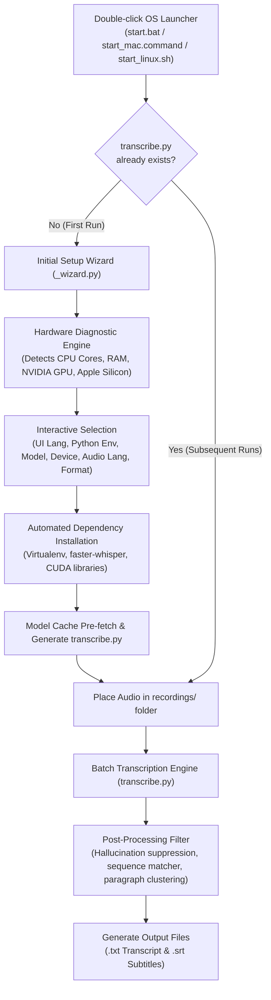

# 🎙️ Whisper Auto Transcriber

[](https://opensource.org/licenses/MIT)
[](https://www.python.org/downloads/)
[]()
[-orange.svg)](https://github.com/SYSTRAN/faster-whisper)
[](#-acknowledgments--credits)

**Whisper Auto Transcriber** is a zero-configuration, production-grade local audio/video transcription and subtitle generation suite powered by **faster-whisper** (CTranslate2) and **OpenAI Whisper**. 

It runs **100% offline on your local machine**, ensuring complete privacy, zero API costs, and no file length limitations. Designed with an interactive setup wizard that automatically diagnoses your system hardware (CPU, RAM, GPU, Apple Silicon Unified Memory) and configures the optimal compute precision and model architecture for maximum speed and accuracy.

---

## 🌟 Key Highlights

- **🖱️ Native 1-Click Launchers**:
  - **Windows**: `start.bat` (batch execution with automatic environment discovery)
  - **macOS**: `start_mac.command` (native double-clickable via Finder with Apple Silicon acceleration)
  - **Linux / Unix**: `start_linux.sh` or universal `start.sh` (POSIX compliant)
- **🧠 Granular Hardware Auto-Tuning**: Real-time diagnostic engine evaluates your CPU core count, system RAM, NVIDIA CUDA VRAM, and Apple Silicon Unified Memory across 6 distinct hardware tiers to automatically recommend and configure the most efficient Whisper model.
- **⚡ Next-Gen Model Support**:
  - Full support for standard CTranslate2 models (`tiny`, `base`, `small`, `medium`, `large-v3-turbo`, `large-v3`).
  - Includes the latest **`large-v3-turbo`** (8x faster inference with flagship Large-v3 accuracy).
  - Built-in **Developer Mode** (`dev`) unlocking OpenAI PyTorch reference models.
- **📄 Dual Output Format Generation**:
  - **SRT Subtitles (`.srt`)**: Millisecond-accurate timestamped subtitles ready for Premiere Pro, DaVinci Resolve, Final Cut, and YouTube.
  - **Clean Paragraph Text (`.txt`)**: Intelligently merged paragraphs with timestamp intervals, hallucination suppression, and duplicate filter post-processing.
- **🌐 Multilingual Setup Wizard**: Full 4-language terminal UI support (English, Japanese, Chinese, Korean).
- **🛡️ 100% Private & Self-Contained**: Creates an isolated virtual environment (`venv`). All model weights and audio data stay strictly on your local device.

---

## 🏗️ Architecture & Workflow



---

## 📊 Hardware-Driven Model Recommendation Matrix

The system dynamically assesses your physical machine specifications and applies **`(Recommended)`** tags accordingly:

| Compute Tier | Physical Hardware Specs | Default Device | Recommended Model | Typical Target Hardware |
| :--- | :--- | :--- | :--- | :--- |
| **Tier 1 (Flagship GPU)** | NVIDIA VRAM **≥ 11.0 GB** | `[2] GPU Fast Mode` | **`[6] Large-v3`** | RTX 4090, 4080, 4070 (12GB), RTX 3060 (12GB) |
| **Tier 2 (Mainstream GPU)** | NVIDIA VRAM **6.0 ~ 10.9 GB** | `[2] GPU Fast Mode` | **`[5] Turbo`** | RTX 5050 (8GB), RTX 4060, RTX 3060 (6GB) |
| **Tier 3 (Budget GPU)** | NVIDIA VRAM **3.5 ~ 5.9 GB** | `[2] GPU Fast Mode` | **`[4] Medium`** | GTX 1650 (4GB), RTX 3050 (4GB), Quadro T1000 |
| **Tier 4 (Entry GPU)** | NVIDIA VRAM **2.0 ~ 3.4 GB** | `[2] GPU Fast Mode` | **`[3] Small`** | GTX 1060 (3GB), MX450, GTX 1050 (2GB) |
| **Tier 5 (Apple Silicon Pro)** | macOS M-Series & RAM **≥ 15.0 GB** | `[1] CPU Mode` | **`[5] Turbo`** | Apple Silicon M1/M2/M3/M4 Pro/Max (16GB+ Unified) |
| **Tier 6 (Apple Silicon Base)**| macOS M-Series & RAM **7.5 ~ 14.9 GB** | `[1] CPU Mode` | **`[3] Small`** | Apple Silicon M1/M2/M3/M4 (8GB Unified Memory) |
| **Tier 7 (High-End CPU)** | CPU Cores ≥ 6 & System RAM **≥ 7.5 GB** | `[1] CPU Mode` | **`[3] Small`** | Modern Intel Core i5/i7/i9, AMD Ryzen 5/7/9 |
| **Tier 8 (Standard CPU)** | CPU Cores ≥ 4 & System RAM **≥ 5.5 GB** | `[1] CPU Mode` | **`[2] Base`** | Standard office quad-core laptops & mini PCs |
| **Tier 9 (Low-Spec CPU)** | CPU Cores ≤ 2 or System RAM **< 5.5 GB** | `[1] CPU Mode` | **`[1] Tiny`** | Legacy dual-core PCs (prevents out-of-memory lockups) |

---

## 🚀 Quick Start Guide

### Step 1: Prerequisites

Make sure you have **Python 3.9 or higher** installed:
- **Windows**: Download from [python.org](https://www.python.org/downloads/). *(Important: Check **"Add Python to PATH"** during setup!)*
- **macOS**: Install via Homebrew: `brew install python`
- **Linux (Ubuntu/Debian)**: `sudo apt update && sudo apt install python3 python3-venv`

### Step 2: Download & Launch

1. Clone or download this repository:
   ```bash
   git clone https://github.com/PLAN-L/Whisper-Auto-Transcriber.git
   cd Whisper-Auto-Transcriber
   ```
   *(Or download the `.zip` archive from [Releases](https://github.com/PLAN-L/Whisper-Auto-Transcriber/releases) and extract it).*

2. Run the launcher for your operating system:
   - **Windows**: Double-click `start.bat`.
   - **macOS**: Double-click `start_mac.command`.
     *(If prompted by macOS Gatekeeper, grant execute permission once in Terminal: `chmod +x start_mac.command`).*
   - **Linux**: Execute in terminal:
     ```bash
     chmod +x *.sh
     ./start_linux.sh
     # (or simply: ./start.sh)
     ```

### Step 3: Complete the Interactive Setup Wizard

The wizard will display your detected hardware specs and guide you through 4 quick steps:
1. **Environment Setup**: Isolated `venv` (recommended) or global system Python.
2. **Model Selection**: Choose your model (press Enter to accept the detected `(Recommended)` model).
3. **Compute Device**: Choose CPU or GPU CUDA acceleration.
4. **Target Language & Format**: Select multilingual auto-detect or a specific language, and pick your preferred output format (`.txt`, `.srt`, or both).

### Step 4: Drop Audio and Transcribe

1. Place your target audio or video files into the newly created `recordings/` directory:
   - Supported formats: `.mp3`, `.wav`, `.m4a`, `.mp4`, `.aac`, `.flac`, `.ogg`, `.wma`, `.webm`
2. Run your OS launcher (`start.bat` / `start_mac.command` / `start_linux.sh`) again.
3. Your finished transcriptions (`filename_transcript.txt`) and subtitles (`filename_transcript.srt`) will be generated right next to your script.

---

## 🛠️ Advanced Usage & Developer Mode

### Reconfiguring Settings
To change your model, device, or output preferences, simply delete the generated `transcribe.py` file and re-run your OS launcher. The setup wizard will launch automatically.

### Developer Mode (OpenAI PyTorch Whisper Reference Engine)
If you wish to test official PyTorch Whisper models rather than the optimized CTranslate2 engine:
- Launch via terminal with the `--dev` flag:
  ```bash
  # Windows
  start.bat --dev
  
  # macOS / Linux
  ./start.sh --dev
  ```
- Or type `dev` at the model selection prompt. This unlocks PyTorch models `[7]` through `[12]`.

---

## 📁 Repository Structure

```text
Whisper-Auto-Transcriber/
├── start.bat             # 1-Click launcher for Windows (Self-contained wizard & runner)
├── start_mac.command     # 1-Click launcher for macOS (Finder native executable)
├── start_linux.sh        # Dedicated launcher for Linux distributions
├── start.sh              # Universal POSIX Unix launcher (macOS/Linux router)
├── .gitignore            # Protects audio files, output texts, and venv from being committed
├── README.md             # Project documentation & user guide
└── LICENSE               # MIT Open Source License
```

---

## 🤖 Acknowledgments & Credits

- Powered by [faster-whisper](https://github.com/SYSTRAN/faster-whisper), developed by SYSTRAN based on [CTranslate2](https://github.com/OpenNMT/CTranslate2).
- Speech recognition models provided by [OpenAI Whisper](https://github.com/openai/whisper).
- *This project was designed, optimized, and cross-platform engineered with assistance from advanced AI pair programming tools.*

---

## 📄 License

This project is open-source software licensed under the [MIT License](LICENSE).
